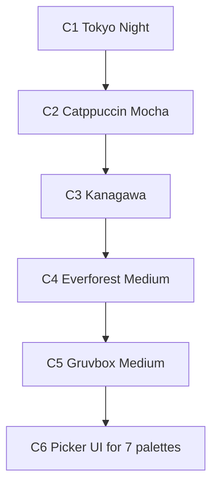

# Community Palettes (Tokyo Night / Catppuccin / Kanagawa / Everforest / Gruvbox) — Implementation Plan

> **Read first**: `AGENTS.md` → `docs/web_design_plan.md` §7 (tokens) → `docs/motion_plan.md` A28 (theme/palette transition).
> Baseline: branch `dev`. No new dependencies (official hex values are facts, copied as literals with source links in comments). Paths relative to repo root.
> Owner decisions (confirmed): Everforest Dark/Light **Medium**, Gruvbox Dark/Light **Medium**, Catppuccin **Mocha**.

## How agents must work

1. One palette at a time (C1 → C5), then C6 (picker UI). Do not widen scope.
2. Each item lists **Files / Do / Tests / Done when**. Done only when `npm run lint && npm test && npm run build` pass.
3. Every new palette ships **both light and dark** (3 CSS blocks like `forest`); dark first, light after; every text/background pair must pass the existing WCAG AA contrast suite — no exceptions, tune the mapping until green.
4. One palette = one commit: `feat(web): add <name> palette`.

## Dependency graph

## Palette definitions (final)

| # | Palette | Dark variant | Light variant | Accent |
|---|---|---|---|---|
| 0 | Indigo default (unchanged) | — | — | `#4f46e5` |
| 1 | Forest (unchanged) | — | — | `#1b633e` |
| 2 | Tokyo Night | Storm `#24283b` | Day `#e1e2e7` | Blue `#7aa2f7` |
| 3 | Catppuccin | Mocha `#1e1e2e` | Latte `#eff1f5` | Mauve/Sapphire per mode |
| 4 | Kanagawa | Wave `#1f1f28` | Lotus `#f2ecbc`-family | Crystal blue `#7e9cd8` |
| 5 | Everforest | Dark Medium `#2d353b` | Light Medium `#fdf6e3`-family | `#7fbbb3` dark / `#8da101` light |
| 6 | Gruvbox | Dark Medium `#282828` | Light Medium `#fbf1c7` | `#83a598` dark / `#076678` light |

---

## C1 — Tokyo Night (Storm / Day)

**Files**: `web/src/styles/tokens.css`, `web/src/utils/cssTokens.ts` (`readThemes`), `web/src/test/contrast.test.ts`, `web/src/views/SettingsView.tsx` (temp item), `web/src/components/Header.tsx:128-130` (type widening).

**Do**:

1. `tokens.css`: add 3 blocks mirroring `forest` — `:root[data-palette="tokyo-night"]`, `:root[data-theme="dark"][data-palette="tokyo-night"]`, and the `prefers-color-scheme` media twin. Map **all** tokens the `forest` blocks define (bg, surface, surface-hover, border, border-strong, text, muted, accent, accent-hover, on-accent, accent-text, timer-over/on-over/over-text, danger/warning/success families + `*-bg`, info-bg, shadow). Comment the source (`tokyonight.nvim`, Storm/Day). Storm bg `#24283b`, fg `#c0caf5`, accent blue `#7aa2f7`; Day bg `#e1e2e7`, fg `#3760bf`.
2. Introduce a shared `PaletteId` union (`web/src/utils/palette.ts` or new `theme.ts`; SettingsView + Header import it — no more duplicated `'default' | 'forest'` literals). Unknown stored value falls back to `default`.
3. `cssTokens.readThemes()`: parse the 3 new blocks (same pattern as forest). `contrast.test.ts`: full pair matrix for the new palette in all 3 modes.
4. Switch reuses the existing A28 `theme-transition` mechanism — verify, no second transition path. Harmonize-with-wallpaper keeps overriding (unchanged precedence).

**Tests**: contrast suite green (AA ≥ 4.5:1 small text, ≥ 3:1 large/state); `readThemes` returns the new blocks; switching updates `data-palette` + toast names the palette.

**Done when**: selectable end-to-end (temporarily appended to the list), correct in light/dark/system × wallpaper on/off, no contrast failure.

---

## C2 — Catppuccin (Mocha / Latte)

Same Files/Do/Tests/Done as C1 with `data-palette="catppuccin"`. Source: Catppuccin palette (Mocha `#1e1e2e`/`#cdd6f4`, Latte `#eff1f5`/`#4c4f69`). Accent: Mauve (`#cba6f7` dark / `#8839ef` light) for brand, Sapphire for links if needed — keep one accent + one accent-text like other palettes, note any deviation in comments.

---

## C3 — Kanagawa (Wave / Lotus)

Same format with `data-palette="kanagawa"`. Source: `kanagawa.nvim` (Wave `#1f1f28`, Lotus paper `#f2ecbc`-family). Accent: Crystal blue `#7e9cd8`. Note: Lotus is low-contrast by nature — muted text will likely need darkening past upstream values to pass AA; tune until green and record deviations in comments.

---

## C4 — Everforest (Dark Medium / Light Medium)

Same format with `data-palette="everforest"`. Source: `everforest` (Dark Medium bg `#2d353b`/fg `#d3c6aa`, Light Medium bg `#fdf6e3`-family/fg `#5c6a72`). Accent: aqua `#7fbbb3` (dark) / green `#8da101` (light). Everforest green/aqua on dark usually passes AA easily — the light variant's muted (`#939f91`-family) is the tuning risk.

---

## C5 — Gruvbox (Dark Medium / Light Medium)

Same format with `data-palette="gruvbox"`. Source: `gruvbox` (Dark Medium bg `#282828`/fg `#ebdbb2`, Light Medium bg `#fbf1c7`/fg `#3c3836`). Accent: aqua `#83a598` (dark) / blue `#076678` (light). Note: Gruvbox warm gray ramp (`#928374` muted) on `#282828` is the known tight spot — tune muted until the suite passes, comment deviations.

---

## C6 — Picker UI for 7 palettes

**Files**: `web/src/views/SettingsView.tsx:382-395` (Color Palette row), new `web/src/components/ui/PalettePicker.tsx` (or extend SegmentedControl — pick one, no two pickers), `web/src/test/**`.

**Do**:

1. Replace the 2-item `SegmentedControl` with a swatch radio group: one button per palette showing 3 dots (bg / accent / text) + name below; `role="radiogroup"`, arrow-key navigation, visible focus ring, `aria-checked`. Seven items: grid 4+3, wrapping to 2 rows at 360px without overflow.
2. Keep the toast on switch ("Switched palette to …"); keep persistence key `let_timer_palette` (old `default`/`forest` values keep working).

**Tests**: render test (7 options, checked state follows value, arrows move selection, `onValueChange` fires); Playwright: switch each palette, screenshot 360/1280px light/dark into `web/.design/palettes/` (git-ignored).

**Done when**: all 7 choosable by mouse + keyboard-only; no overflow at 360px.

---

## Acceptance checklist

- [ ] `npm run lint && npm test && npm run build` pass.
- [ ] 7 palettes × light/dark/system × wallpaper on/off render correctly; A28 transition runs on every switch.
- [ ] Contrast suite covers all palettes; zero AA failures.
- [ ] Old `localStorage` values (`default`/`forest`/garbage) migrate safely.
- [ ] Screenshots matrix archived in `web/.design/palettes/`.

## Explicitly out of scope

New fonts; auto-switch palette by time of day; per-palette wallpaper images; syncing palette across devices; changing `forest`/default values.

## Open points for the owner (all answered except H3)

| # | Point | Decision |
|---|---|---|
| H1 | Catppuccin dark flavor | **Mocha** (confirmed) |
| H2 | Everforest/Gruvbox flavors | **Medium** both modes (confirmed) |
| H3 | Screenshot review | Reviewer checks one matrix at the end (C6) instead of per-palette |
