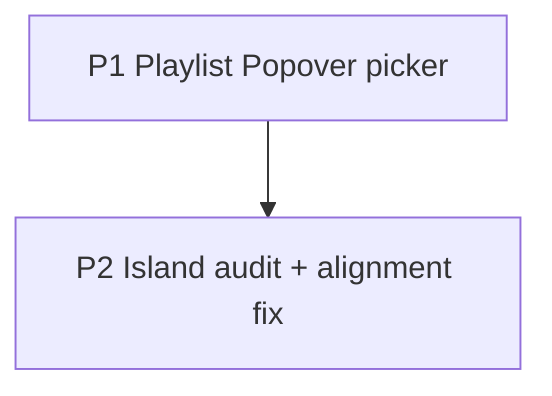

# Focus Playlist Picker + Island Alignment — Implementation Plan

> **Read first**: `AGENTS.md` (motion rules: one engine per element) → `docs/web_design_plan.md` §4/§8 (Focus, Start picker pattern) → `docs/motion_plan.md` A26 (music sheet), A08/A09 (pill enter/exit).
> Baseline: branch `dev`. No new runtime dependencies. Paths relative to repo root.

## How agents must work

1. Two workstreams P1 (select) → P2 (islands); P2 audit first, then fix.
2. Each item lists **Files / Do / Tests / Done when**. Done only when `npm run lint && npm test && npm run build` pass.
3. No visual redesign beyond the two fixes; keep the pill's look, only correct geometry.
4. One workstream = one commit: `feat(web): …` / `fix(web): …`.

## Dependency graph

P1 first (isolated), P2 after (touches the same Focus area).

---

## P1 — Replace native playlist `<select>` with the Popover listbox (Focus)

**Files**: `web/src/views/FocusView.tsx:256-291`, `web/src/components/ui/{Popover,DropdownMenu}.tsx` (reuse, no changes expected), `web/src/test/**` (new test).

**Background**: `FocusView.tsx:270-288` uses a native `<select>`. The repo's `Field.Select` is still a native `<select>` underneath (only styled), so it does not solve the complaint. The true custom pattern available is the Radix `Popover` + list (workspace switcher at `Header.tsx:265-352`, filters at `TodayView.tsx:661-727`). No `@radix-ui/react-select` dependency exists — do not add one.

**Do**:

1. Replace the `<select>` with a Radix `Popover` trigger styled exactly like the current pill (`Music` icon + label + chevron), following the workspace-switcher pattern: `PopoverContent` list of playlists with check mark on the selected one, `role="listbox"`/`role="option"` + `aria-selected`, `Esc` closes, focus returns to trigger (Radix default — verify, do not reimplement).
2. Keep behavior identical: selecting sets `selectedMediaListId` + calls `loadMediaListForTask(val)`; empty state shows "No playlists available" (disabled trigger, not a fake option).
3. Popup must be opaque (`opaque-surface` rule in `tokens.css` already covers Radix popover content — verify over wallpaper photo, both themes).
4. Mobile: popover opens upward (`side="top"`) so the on-screen keyboard/finger never covers it; list scrolls (`max-h` + overflow) for many playlists.

**Tests** (Vitest + Testing Library): closed shows current playlist name; open lists all + check on selected; selecting calls the loader with the id; empty list disables trigger. Playwright: keyboard-only (Tab → Enter → arrows → Enter) selects a playlist.

**Done when**: no `<select>` remains in `FocusView`; OS-native dropdown never appears; works over wallpaper photo in light/dark, 360px wide.

---

## P2 — Island alignment audit + fix

**Files**: `web/src/components/FloatingPlayerIsland.tsx` (`:194-210` root, `:575-646` pill), `web/src/views/FocusView.tsx:374-384`, `web/src/App.tsx:196-231`, `web/src/components/TimerBar.tsx:232+` (music section), `web/src/components/BottomTabBar.tsx`, `web/e2e/**`.

**Background / diagnosis**: `FloatingPlayerIsland` mounts in two places — the App dock (`App.tsx:218-229`, plain island inside a `fixed ... left-1/2 -translate-x-1/2` wrapper) and the Focus center stage (`FocusView.tsx:380-383`, where `absolute bottom-0 left-1/2 -translate-x-1/2` sits **on the island root itself**). Both instances share `layoutId="floating-island"` with **no common `LayoutGroup`**. Prime suspect for the reported offset: when entering/leaving Focus, Motion's shared-element transition carries a stale x/y transform onto the newly mounted pill. Secondary suspects inside the pill: `TimerDigits size="inline"` (mono) next to a sans `font-semibold` track name (baseline mismatch), asymmetric `ml-0.5` on the Play icon only, and the `SoundWave`/`Music` icon swap changing the row's basis.

### P2.0 Audit (do first, record results in the commit message)

1. List every floating/fixed-bottom element: player dock, timer dock, Focus island, Toasts viewport, BottomTabBar. Screenshot each at 360/768/1280px.
2. Confirm/refute the shared-`layoutId` hypothesis: with Motion devtools or by temporarily scoping `layoutId` per mount (`floating-island-focus` vs `floating-island-dock`, or a `LayoutGroup`), check whether the Focus pill recenters.

### P2.1 Fix

1. **Centering**: move the `absolute bottom-0 left-1/2 -translate-x-1/2` positioning off the island root into the Focus wrapper (mirror the App dock: a plain positioned wrapper + unpositioned island inside), so Motion's `transform` (scale on pill/card) never shares an element with the CSS centering translate. One engine per element — the translate belongs to the wrapper, the scale to the pill.
2. **Shared layout**: either wrap both mounts in one `LayoutGroup id="player-island"` or scope the `layoutId` per location — pick the one that keeps the expand/collapse morph (A26) and removes the cross-view offset. Never keep two live `layoutId="floating-island"` instances without a group.
3. **In-pill rhythm**: unify the row to a fixed height (`h-6`, matching the play button): icon box `w-6 h-6 grid place-items-center` for `Music`/`SoundWave` (no size swap on play/pause), track-name + `TimerDigits` sharing one baseline (`leading-none`, remove `ml-0.5` asymmetry — use symmetric optical centering or none on both icons).
4. Re-check prereq 0.3 (bottom padding = pill height + safe area) on every view after the geometry change.

**Tests**: Playwright CLS check — expand/collapse in Focus shifts the clock < 0.01 (existing `focus` spec); new spec: pill's bounding-box center vs viewport center differs by ≤1px in Focus and in dock, idle + playing, at 360/768/1280px; no element carries both a Motion transform and a CSS translate (assert via `getAnimations()` + computed `transform` on the wrapper vs pill).

**Done when**: the Focus pill is pixel-centered; navigating Focus ↔ other views leaves no offset; play/pause toggle causes zero layout shift.

---

## Acceptance checklist

- [ ] `npm run lint && npm test && npm run build` pass.
- [ ] Focus playlist: custom popup, keyboard-operable, opaque over wallpaper, no native dropdown.
- [ ] All floating islands centered ≤1px at 360/768/1280px; no cross-view offset; no play/pause shift.
- [ ] `/dev/motion` + affected screens checked in Full/Reduced/Off.

## Explicitly out of scope

Adding `@radix-ui/react-select` (unneeded — Popover pattern exists); restyling the pill; touching `MediaView.tsx:812` native select (same smell — file as backlog or follow-up, do not bundle); BottomTabBar redesign.

## Open points for the owner

| # | Point | Default used |
|---|---|---|
| H1 | "Existing custom select" = Popover listbox pattern (`Field.Select` is still native, excluded) | Popover, matching workspace switcher |
| H2 | Mobile picker: popover-up vs bottom sheet | Popover `side="top"` (light); sheet only if testing shows crowding |
| H3 | If shared-`layoutId` is not the offset cause | P2.0 audit decides; record outcome in the commit message |
