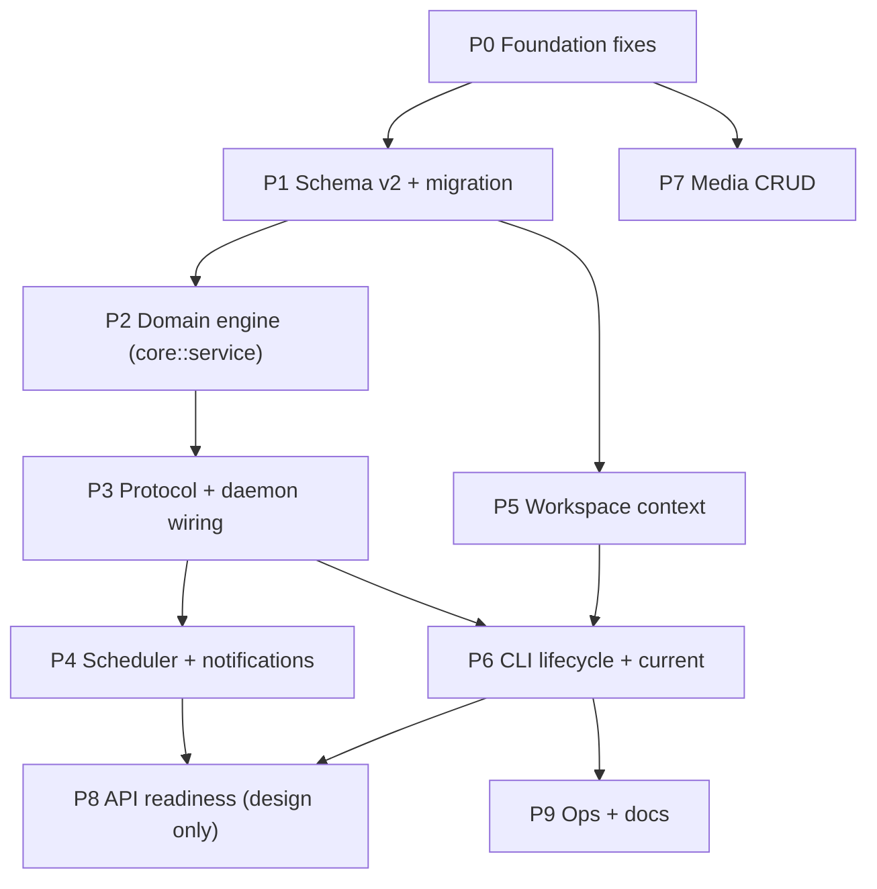

# Let-timer — Implementation Plan (v2)

> **Read first**: [`AGENTS.md`](AGENTS.md) (conventions) → [`docs/PRODUCT_SPEC.md`](docs/PRODUCT_SPEC.md) (what to build, requirement IDs `R1…`, decisions `D1…`).
> This file says **in what order and how**. If the spec and this plan disagree, the spec wins — fix the plan.
> Paths are relative to the repo root. Line numbers are deliberately omitted (they rot); search by symbol.
> Branch: `dev`.

## How agents must work

1. Take **one phase** (or one numbered item) at a time. Do not start a phase before its dependencies are merged.
2. Each item lists **Files**, **Do**, **Tests**, **Done when**. An item is finished only when `cargo fmt`, `cargo clippy --workspace -- -D warnings` and `cargo test --workspace` pass.
3. Wire-format (`protocol`) or DB-schema changes: update `docs/PRODUCT_SPEC.md` and the "Database Schema" section of `AGENTS.md` in the same change.
4. Do not widen scope. If you find a bug outside your item, add it to the "Backlog" at the bottom instead of fixing it silently.

## Current state (verified against `dev` @ `c718e60`)

- `Start/Stop/Done/Current` in `daemon/main.rs::invoke_command` are stubs that print and return `OkEmpty` / `TaskPayload::None` — the user sees success while nothing happened.
- `daemon/lib.rs` has `current_task()` / `start_task()` that `main.rs` never calls; `start_task(None)` returns `OkEmpty`.
- `TaskRepository::start_task` is only `set_status(InProgress)`: no one-at-a-time guard.
- `get_list_task` is **either** status filter **or** priority sort — never both.
- `UpdateTask.estimated_mins` is `Option<i64>` → an estimate can never be cleared (other nullable fields use `Option<Option<_>>`).
- `Command::Edit` accepts `status` → can bypass any lifecycle rule.
- Schema is v1; `tasks.status` has a CHECK without `paused`; no timer storage; no workspace context; no media CRUD beyond `ListMediaLists` / `CreateMediaList`.
- `ipc/server.rs`: invalid JSON closes the connection without replying; `bind` fails on a stale socket after a crash; `expect("serialize")`.

## Dependency graph



Parallelisable: after P1, **P2→P3→P4** and **P5** are independent tracks; **P7** can run any time after P0.

---

## P0 — Foundation fixes (blocking)

**Goal**: nothing lies, nothing panics, and wire changes that are cheap _now_ (no external consumers) are done once.

| #   | Item                           | Files                                                      | Do                                                                                                                                                                                                                                                                                                  |
| --- | ------------------------------ | ---------------------------------------------------------- | --------------------------------------------------------------------------------------------------------------------------------------------------------------------------------------------------------------------------------------------------------------------------------------------------- |
| 0.1 | Honest stubs                   | `daemon/src/main.rs`                                       | Remove `println!` stubs. `Start/Stop/Done/Current` return `Response::Error { message: "not implemented yet" }` until P3. Rename `_db` → `db_guard`; replace `lock().unwrap()` with `unwrap_or_else(\|e\| e.into_inner())` (recover from poison).                                                    |
| 0.2 | IPC robustness                 | `core/src/ipc/server.rs`, `ipc/mod.rs`                     | Bad JSON → reply `Response::Error` and keep the connection. No `expect` on serialize. On startup, if the socket file exists and `connect` fails, remove it and bind; if connect succeeds, exit with "daemon already running". `HOME` missing → error, not panic (`connection.rs::default_db_path`). |
| 0.3 | Env overrides for tests        | `ipc::socket_path`, `connection.rs`                        | `LET_TIMER_SOCKET` and `LET_TIMER_DB` override default paths. Needed for e2e tests and for running a dev daemon beside the real one.                                                                                                                                                                |
| 0.4 | Clearable / validated estimate | `models.rs`, `task_repository.rs`, `cli.rs`, `cli/main.rs` | `UpdateTask.estimated_mins: Option<Option<i64>>` (use `double_option`). Reject `estimated_mins <= 0` in `create` and `update` (`DbError::Invalid…`).                                                                                                                                                |
| 0.5 | Wire cleanups                  | `protocol/mod.rs`, daemon, `render.rs`, tests              | `TaskPayload` → `Option<Task>` (`Response::Ok(Option<Task>)`); `MediaListList` → `MediaLists`. Update `json_is_the_reply_itself`.                                                                                                                                                                   |
| 0.6 | Remove duplicated PRAGMA       | `connection.rs`                                            | `foreign_keys = ON` appears twice.                                                                                                                                                                                                                                                                  |

**Tests**: bad-JSON reply; stale-socket startup; clearing an estimate over JSON (`{"estimated_mins": null}` vs absent); `estimated_mins = 0` rejected.
**Done when**: no `unwrap()` in non-test daemon code; all existing tests pass.

### P0b — Cosmetic track (any time, never blocks)

Derive `clap::ValueEnum` for `Priority/TaskStatus/SortOrder` (or CLI-local wrappers if you don't want `clap` in core); replace magic string `message == "Priority"` in `interactive.rs::default_cursor` with a `default_value` param; replace the 8-argument `build_new_task` with a struct. Kept from the previous plan, intentionally decoupled from feature work.

---

## P1 — Schema v2 + migration

**Goal**: storage for paused status, sessions, settings, workspace default. Spec §4–§7.

**Files**: `core/src/db/connection.rs` (+ tests).

> ⚠ `CREATE TABLE IF NOT EXISTS` does **not** change an existing table's CHECK constraint. Updating `SCHEMA_SQL` alone leaves existing databases rejecting `status = 'paused'`. The `tasks` table must be **rebuilt** in the migration.

**Do** (bump `SCHEMA_VERSION` to 2, add `if current < 2 { … }` in `migrate()`):

1. Rebuild `tasks` (SQLite recipe): `PRAGMA foreign_keys = OFF` (must be **outside** the transaction) → `BEGIN` → create `tasks_new` with the new definition → `INSERT … SELECT` → `DROP TABLE tasks` → `ALTER TABLE tasks_new RENAME TO tasks` → recreate indexes (`idx_tasks_scheduled_on`, …) → `PRAGMA foreign_key_check` (must be empty) → `COMMIT` → `PRAGMA foreign_keys = ON`.
   New columns: `run_no INTEGER NOT NULL DEFAULT 0`, `notified_at TEXT`. New CHECK adds `'paused'`.
2. Create:

   ```sql
   CREATE TABLE IF NOT EXISTS task_sessions (
       id         INTEGER PRIMARY KEY AUTOINCREMENT,
       task_id    INTEGER NOT NULL REFERENCES tasks(id) ON DELETE CASCADE,
       run_no     INTEGER NOT NULL,
       started_at TEXT    NOT NULL,           -- RFC 3339 UTC
       ended_at   TEXT,                       -- NULL while running
       end_reason TEXT CHECK (end_reason IN
                  ('paused','stopped','completed','cancelled','restarted'))
   );
   CREATE INDEX IF NOT EXISTS idx_sessions_task ON task_sessions (task_id, run_no);
   -- DB-level guarantee of R4: at most one open session in the whole table.
   CREATE UNIQUE INDEX IF NOT EXISTS idx_one_open_session
       ON task_sessions ((1)) WHERE ended_at IS NULL;

   CREATE TABLE IF NOT EXISTS settings (
       key   TEXT PRIMARY KEY,
       value TEXT NOT NULL
   );
   ```

3. Ensure a workspace `Default` exists when there are none; set `settings.active_workspace_id` if unset or pointing at a missing workspace.
4. Fresh databases must end up **identical** to migrated ones: `SCHEMA_SQL` carries the v2 definitions; `migrate` only touches databases with `user_version < 2`.

**Tests**: create a v1 DB (old schema SQL) with tasks in every status + a workspace → open with the new code → rows preserved, `paused` insertable, FKs intact, `PRAGMA foreign_key_check` empty; fresh-DB vs migrated-DB `PRAGMA table_info` equal; second open is a no-op; inserting two open sessions fails.
**Done when**: migration test passes against a real **file** DB (not only in-memory).

---

## P2 — Domain engine (`core::service`)

**Goal**: all lifecycle/timer rules in one transport-agnostic, deterministic module. Spec §4–§5.

**New files**: `core/src/service/mod.rs`, `service/transition.rs`, `service/snapshot.rs`, `db/session_repository.rs`; export from `lib.rs`.

**Do**:

1. `transition.rs` — pure function `next_status(current: TaskStatus, action: Action, force: bool) -> Result<TaskStatus, TransitionError>` implementing the spec's table verbatim. `TransitionError` carries a human message ("task #3 is completed; use `reopen`").
2. `snapshot.rs` — `TimerSnapshot { task: Task, state: TimerState /*Idle|Running|Paused|Overtime*/, elapsed_secs, remaining_secs: Option<i64>, workspace_name }` and `TimerSnapshot::compute(task, sessions, now)`; pure.
3. `session_repository.rs` — `open(task_id, run_no, now)`, `close_open(now, reason)`, `sessions_for_run(task_id, run_no)`, `open_session() -> Option<Session>`.
4. `TaskService<'a> { conn: &'a Connection }` with `start(id|None, opts, now)`, `pause`, `resume`, `stop`, `restart`, `done`, `cancel`, `reopen`, `current(now)`. **Every method runs inside one `rusqlite::Transaction`** (status update + session open/close + `notified_at` reset). The one-running check relies on the unique index and on an explicit pre-check for a good error message naming the running task.
5. `start --switch`: pause the running task, then start, in the same transaction.
6. Rules to enforce: spec §4 rules 1–5; `Edit` with `status = Some(_)` is rejected; `delete` of the running task leaves no session (CASCADE).
7. `TaskRepository::start_task/complete_task/cancel_task/set_status` become `pub(crate)` (or removed) so callers cannot skip the service.

**Tests** (no sleeping — pass explicit `now`): every cell of the transition table; elapsed across pause/resume/pause; overtime flips exactly at `estimated_mins × 60`; restart zeroes elapsed but keeps history; stop keeps elapsed (D1); two paused tasks keep separate elapsed; start while another runs → error naming it; `--switch`; estimate edited while running; delete running task; no estimate → `remaining_secs = None`.
**Done when**: 100 % of the transition table is covered by a table-driven test.

---

## P3 — Protocol + daemon wiring

**Goal**: end-to-end lifecycle over IPC. Depends on P2.

**Files**: `protocol/mod.rs`, `daemon/src/main.rs`, `daemon/src/lib.rs`.

**Do**:

1. `Command` adds: `Pause`, `Resume { id: Option<i64> }`, `Restart { id: Option<i64> }`, `Cancel { id: Option<i64> }`, `Reopen { id: i64 }`; changes `Start { id: Option<i64>, next: bool, switch: bool }`, `Done { id: Option<i64>, force: bool }`; replaces `List { sort_priority, filter_status }` with `List(ListQuery { workspace: WorkspaceScope, status, sort_priority, priority, date })` (filters **combine**); `Find` gets a `WorkspaceScope`. `Ping`.
2. `Response` adds `Timer(TimerSnapshot)` (all lifecycle commands return it) and `Pong`.
3. `daemon/lib.rs` holds thin adapters `Command → TaskService call → Response`. `invoke_command` in `main.rs` is a plain `match` with no logic. Remove dead helpers.
4. The daemon passes `Utc::now()` into the service — the only place the real clock is read.
5. `Edit` rejecting `status` (from P2) surfaces as `Response::Error`.

**Tests**: IPC end-to-end using `LET_TIMER_SOCKET`/`LET_TIMER_DB` in a temp dir (spawn `IpcServer` in-process): create → start → pause → resume → done; second `start` errors; `done` on idle errors; list with `status + sort` combined.
**Done when**: the `AGENTS.md` "Adding a feature" checklist is satisfied for each new command, including `every_command_the_daemon_has_is_reachable`.

---

## P4 — Scheduler + notifications (R6)

**Goal**: notify once when the running task's time is up. Depends on P3.

**New files**: `daemon/src/scheduler.rs`, `core/src/notify.rs` (or `daemon/src/notify.rs`).

**Do**:

1. `trait Notifier: Send + Sync { fn notify(&self, title: &str, body: &str); }` — `NotifySend` (spawns `notify-send`, errors logged not propagated), `LogNotifier`/`RecordingNotifier` for tests.
2. `Scheduler` is a tokio task owning a `tokio::sync::Notify` (or `watch`). Loop: read running task + sessions → compute `deadline` → `select!` on `sleep(min(deadline − now, 30 s))` and `changed()`. The 30 s cap makes it robust against clock jumps and laptop suspend; on each wake recompute and fire if `remaining <= 0 && notified_at IS NULL`.
3. After any lifecycle command that affects the timer (`start/pause/resume/stop/restart/done/cancel/edit-estimate/delete`) the handler pokes the scheduler.
4. On fire: send notification (title "Time's up", body = task name + estimate), set `tasks.notified_at = now`. **Do not change the task's status** (R6/R7).
5. On daemon boot: re-arm; if the running task is already overtime and `notified_at IS NULL`, notify immediately.
6. Replace the sync `Mutex<Database>` hand-off if needed so the scheduler and IPC handler share the DB without blocking the runtime for long (short critical sections; no `await` while holding the lock).

**Tests** (`tokio::time::pause()` + `RecordingNotifier`): fires once at the deadline; not again after more time; pause before deadline → no fire; resume re-arms; restart clears `notified_at` and fires again; extending the estimate re-arms; boot-time catch-up notification; task without estimate never fires; status stays `in-progress` after firing.
**Done when**: a manual smoke test (documented in the PR) shows a desktop notification for a 1-minute task and the task is still `in-progress` afterwards.

---

## P5 — Workspace context (R8)

**Goal**: active workspace owned by the daemon. Depends on P1; independent of P2–P4.

**Files**: `db/settings_repository.rs` (new), `workspace_repository.rs`, `protocol/mod.rs`, daemon, CLI.

**Do**:

1. `SettingsRepository::get/set`; helpers `active_workspace_id()` with fallback to the first workspace.
2. Protocol: `SwitchWorkspace { target: IdOrName }`, `ActiveWorkspace`, `Response::Workspace` reused. Unknown target → error listing available workspaces.
3. Daemon resolves `WorkspaceScope::Active` for `List/Find/Create/Start(next|picker candidates)`. `Create` with no `workspace_id` uses the active workspace (server-side default, so CLI and future web behave the same).
4. Workspace deletion rules (spec §7): never delete the last one; deleting the active one switches to another. Add `workspaces delete` only if you also add the confirmation prompt (destructive: CASCADE deletes tasks).
5. CLI: `workspaces switch [id|name]` (picker when omitted; confirmation "Switched to workspace: Study (#2)"), `workspaces current`; `--workspace` / `--all-workspaces` on `tasks list/find`. **No `state.json`.**
6. Render: header `Workspace: Study (#2)` above task tables (not in `--json`).

**Tests**: switching changes `list` results; `create` lands in the active workspace; switch by name; switching does not affect a running task; deleting the active workspace falls back; `--all-workspaces`.

---

## P6 — CLI lifecycle + `current`

**Goal**: user-facing commands. Depends on P3 and P5.

**Files**: `cli/src/cli.rs`, `main.rs`, `interactive.rs`, `render.rs`.

**Do**: implement the spec §8 table:

1. New `TaskCommand` variants: `Pause`, `Resume`, `Restart`, `Cancel`, `Reopen`; extend `Start { id, next, switch }`, `Done { id, force }`.
2. `tasks start` with no id and interactive → `inquire::Select` over candidates (pending + paused, active workspace, ordered per spec). `--no-interactive` without id and without `--next` → usage error. Candidates come from a daemon command (`StartCandidates`) so ordering logic isn't duplicated in the CLI.
3. `tasks current --format text|short|json` per spec; `short` prints nothing and exits 0 when the daemon is unreachable.
4. `tasks edit`: add `--estimated-mins` (and `--clear-estimate`), `--media-list-id`. **Do not add `--status`** (the previous plan had it; it conflicts with the lifecycle rules).
5. `tasks list`: `--today`, `--date`, `--sort-priority`, `--priority-label`, `--all-workspaces`; rename the old `--priority` sort flag (D6). Optional `--columns` from `docs/tmp-command.md`.
6. Render: lifecycle commands print a one-line confirmation + snapshot (`Started #3 "Read chapter 3" — 25:00 remaining`). Errors go to stderr with exit code from `Failure`.

**Tests**: clap parse tests for every new command (update `every_command_the_daemon_has_is_reachable`); render tests for each `short` state (idle, countdown, no estimate, overtime, paused); `--json` equals the raw response.

---

## P7 — Media CRUD (R9)

**Goal**: MediaLists are actually usable and assignable. Independent track after P0.

**Do**: `Command` + daemon + CLI for `medias create/list/delete`, `media-lists add-media/remove-media/show` (join table `media_media_list` already exists; `MediaRepository`/`MediaListRepository` exist — wire them). Assign a list to a task through `tasks create/edit --media-list-id`. Decide and document `Media.content` for poems (spec §9.5) with a v3 migration if adopted. **No terminal rendering of media.**
**Tests**: add/remove idempotency (UNIQUE), deleting a media or list cascades the join rows, deleting a list sets `tasks.media_list_id` NULL.

---

## P8 — API readiness (design only; no HTTP server yet)

**Do**: write `docs/API_DESIGN.md` — resource list (tasks, workspaces, timer, media-lists, medias), the lifecycle as `POST /tasks/{id}/start|pause|…`, `GET /timer` returning `TimerSnapshot`, an event stream (SSE) fed by the scheduler, auth (localhost bind + token), CORS, versioning of DTOs. Verify P2/P3 kept the service transport-agnostic (no `ipc`/`clap` types in `core::service`). Add a `Command → HTTP` mapping table. No code beyond small refactors that remove IPC coupling.

---

## P9 — Ops + docs

1. systemd **user** unit (`let-timer-daemon.service`) and a `devenv.nix` process entry; document `systemctl --user restart let-timer-daemon` (replaces the old draft's `restart`).
2. `let-timer daemon status` (ping; shows version, socket, DB path, running task).
3. Replace `docs/tmp-command.md` with `docs/commands.md` generated from the spec §8 table; delete the draft.
4. README quick-start (build, run daemon, daily workflow example).

---

## Test strategy (all phases)

- **Pure logic** (`transition`, `snapshot`) — table-driven, explicit `now`; no sleeps.
- **Repositories/service** — `Database::open_in_memory()`; migration tests use a **file** DB in a temp dir.
- **Scheduler** — `tokio::time::pause()` + `RecordingNotifier`.
- **IPC end-to-end** — temp socket/DB via env overrides; skip gracefully only for tests that need an _external_ daemon.
- **CLI** — clap parse tests + render tests; no real terminal.

## Risks

| Risk                                         | Mitigation                                                                                                              |
| -------------------------------------------- | ----------------------------------------------------------------------------------------------------------------------- |
| Migration corrupts user data (table rebuild) | Back up the DB file before migrating v1→v2 (`let-timer.db.bak-v1`); migration test with real data; `foreign_key_check`. |
| Status and timer drift apart                 | Single transaction in `TaskService`; DB unique index on open sessions; repository status setters not public.            |
| Scheduler holds the DB lock                  | Short critical sections, no `await` under lock, test with concurrent `current` calls.                                   |
| Wire changes after the public API ships      | Freeze DTOs at P8; version the API.                                                                                     |
| Clock changes / suspend                      | Wall-clock design (D3), 30 s scheduler cap, snapshot always recomputed.                                                 |

## Backlog (not scheduled)

Repeat reminders (`reminder_interval`); `tasks current --watch` streaming (needs server push); recurring tasks; time reports per task/workspace/day (data already available from `task_sessions`); `Media.content` for poems; macOS/other notifiers; `--columns` for `list`.
