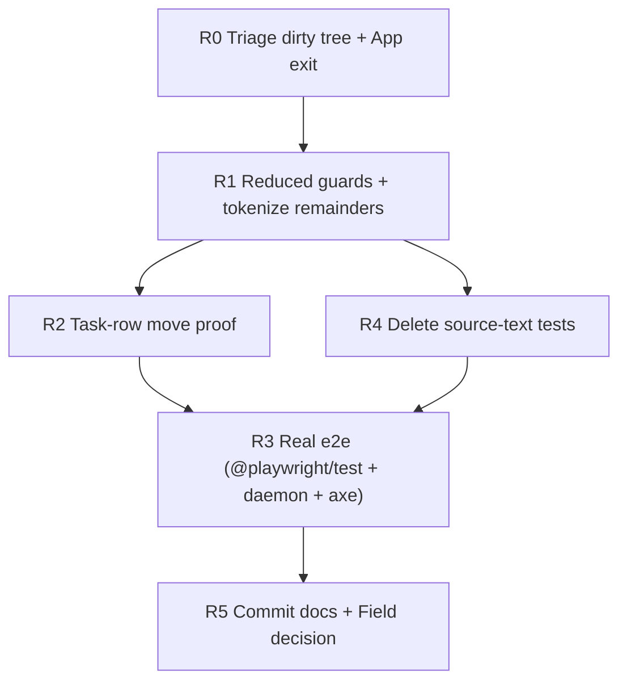

# Motion Fixes, Round 2 — Implementation Plan

> **Read first**: `AGENTS.md`, `docs/motion_plan.md` (moments A01–A33, tokens, calm budget), `docs/motion_fix_handoff.md` (round-1 tasks T1–T7).
> Baseline: branch `dev` @ `2e5fb75` (round-1 T1–T7 committed) plus a dirty tree of ~10 web files — see R0.1.
> This file says **in what order and how**. If it disagrees with `docs/motion_plan.md`, the plan wins for motion behavior — fix the spec doc in the same change.
> Requirement IDs here are `R1…R5`; findings from the round-1 review are `F1…F8` in `docs/motion_fix_handoff.md` plus `G1…G8` below.

## How agents must work

1. One task (R0–R5) at a time, in dependency order. Do not widen scope.
2. Every task lists **Files / Do / Tests / Done when**. A task is finished only when `npm run lint && npm test && npm run build` pass, plus its own e2e/manual checks.
3. Motion rules still apply: **one engine per element** (ownership table in `motion_fix_handoff.md` §1), tokens only, no raw timings/easings in TSX, compositor-friendly properties (`transform`, `opacity`, color; A21/A33 height exceptions only), reduced/off parity.
4. Do not change visual design, copy, or layout. Do not add runtime dependencies; only the dev dependencies named in R3.
5. Every task ends with a manual check of `/dev/motion` and the affected screens in **Full**, **Reduced**, **Off** (and Full with the OS set to reduce).
6. One task = one commit, message `fix(motion): …` listing the `G` ids it closes.

## Findings from the round-1 review (why round 2 exists)

| # | Finding (evidence) | Task |
|---|---|---|
| G1 | Dirty tree on top of `2e5fb75`: `App.tsx`, `FloatingPlayerIsland.tsx`, `Header.tsx`, `ViewHost.tsx`, `WallpaperLayers.tsx`, `AudioPlayerContext.tsx`, `useWallpaper.ts`, `useMotionTransition.ts`, `FocusView.tsx`, `SettingsView.tsx` (~359+/102-). Unclear what belongs to round 2 vs. unrelated work | R0 |
| G2 | `TodayView.tsx:384` row `exit={{ opacity: 0, scale: … }}` is unconditional; `removingIds` only filters the list (`:344`), it does not gate `exit`. A group move therefore plays old-row exit + new-row enter with the same `layoutId` for ~200ms. No test counts nodes mid-move | R2 |
| G3 | `App.tsx:181,200` still contains `exit={{ opacity: 0, y: … }}` — possibly a leftover second view transition next to `ViewHost` | R0 |
| G4 | `slide-date-next/prev` keyframes (`motion.css:157-177`) use hardcoded `translateX(±12px)` with no reduced/off/system-reduced override. The T5 guard only covers `.animate-spin` etc. (`motion.css:269-292`); the requested generic `[class*="animate-"]` guard was not added | R1 |
| G5 | Raw values that slip through the linter: `ViewHost.tsx:17` `travelY = 4` (token `--travel-s` is 8px), `Toast.tsx:40` `y: 12, scale: 0.96`, `TodayView.tsx:396` `ease: 'easeOut'` string + manual `tokens.durSlow / 1000`, `y: 6, scale: 0.98/0.95` in `WorkspacesView.tsx:232`, `MediaView.tsx:668,742,876`, `Header.tsx:288`. Lint only forbids `duration: 0.x` and `ease: [` (`check-motion-tokens.mjs:11-16`) | R1 |
| G6 | `motion.test.ts` still asserts on TSX source via `readFileSync` + `toContain` (`Drawer/Modal/Popover/DropdownMenu/Toast/Button/App/TimerBar/TodayView/FocusView/WallpaperLayers`). Handoff T6a required deleting all of these; only the `motion.css` structure assertions may stay | R4 |
| G7 | e2e does not match the handoff: `playwright-core` + hand-rolled `node e2e/motion.e2e.mjs` instead of `@playwright/test`; mocked `page.route('**/api/v1/**')` instead of a real daemon; hardcoded `/nix/store/…chromium-137…` binary; structural assertions only (no opacity sampling, node counting, CLS, loop scan, OS+Full case, idle-fade/Tab, axe); script is `test:e2e`, handoff required `e2e`; not wired into CI (`ci.yml` web-check runs only lint/test/build) | R3 |
| G8 | Docs not committed: `AGENTS.md` exists on disk but is gitignored (`.gitignore:5`, S0.1 never done) so the motion rules are not fixed for future agents; `docs/motion_fix_handoff.md` is untracked (`??`); `Field.tsx:56,74,92` still uses `border-[var(--border)]/40` + `backdrop-blur-sm` (visual, out of motion scope — tracked here only to decide explicitly) | R5 |

## Dependency graph



R1, then R2/R4 in parallel, then R3, then R5.

---

## R0 — Triage: dirty tree and the `App.tsx` exit (blocking, small)

**Files**: `git status`, `web/src/App.tsx:150-220`, the 10 dirty files listed in G1.

**Do**:

1. Run `git status --short` and `git diff --stat`. Classify each dirty hunk: (a) belongs to R1–R5 below → keep in the tree and implement on top; (b) unrelated → stash or revert, never mix into motion commits.
2. Resolve `App.tsx:181,200`: if those `exit` props are a second view transition competing with `ViewHost`, delete them (ViewHost owns tab transitions). If they belong to a different element (e.g. player/banner), rename/isolate and leave a one-line comment stating the owner. Record the decision in the commit message.

**Tests**: none beyond the repo gates.

**Done when**: the tree contains only round-2 work (or is clean), and exactly one component owns the tab transition.

---

## R1 — Reduced guards + tokenize the remaining raw values (G4, G5)

**Files**: `web/src/styles/motion.css`, `web/src/components/ViewHost.tsx`, `web/src/components/ui/Toast.tsx`, `web/src/views/TodayView.tsx` (`:396` highlight), `web/src/views/WorkspacesView.tsx`, `web/src/views/MediaView.tsx`, `web/src/components/Header.tsx`, `web/scripts/check-motion-tokens.mjs`, `web/package.json`.

**Do**:

1. `motion.css`: add reduced/off/system-reduced overrides for the date-slide classes (fade-only, no travel — same pattern as the existing `.dot-running` block). Add the generic guard from handoff T5:
   ```css
   :root[data-motion="reduced"] [class*="animate-"],
   :root[data-motion="off"] [class*="animate-"] { animation: none !important; }
   @media (prefers-reduced-motion: reduce) {
     :root:not([data-motion="full"]) [class*="animate-"] { animation: none !important; }
   }
   ```
   Verify no legitimate infinite animation (skeleton while loading, equalizer while playing, `Syncing` spinner) is broken by the guard — those classes must be excluded or scoped if the guard catches them.
2. Replace every remaining raw motion literal with tokens (use `useMotionTransition(kind, { exit })` or `useMotionTokens()`; exits use `{ exit: true }`):
   | File | Current | Replace with |
   |---|---|---|
   | `ViewHost.tsx:17,25,27` | `travelY = 4`, `y: travelY / -travelY` | `tokens.travelS` (8px; do not invent a new 4px token — if 4px is a deliberate design choice, add `--travel-xs` to `motion.css` + `tokens.ts` and document it) |
   | `Toast.tsx:40,42` | `y: 12, scale: 0.96 / 0.95` | token kinds (`base`), scale `1` on enter; keep height-collapse only on the delete path |
   | `TodayView.tsx:396` highlight | manual `tokens.durSlow / 1000`, `ease: 'easeOut'` | `useMotionTransition` value |
   | `Workspaces/Media/Header` rows/cards | `y: 6, scale: 0.98/0.95` | same `base` transition as task rows, or record a reason |
3. Extend the lint script so this class of drift cannot return: forbid `y:\s*\d`, `scale:\s*0?\.\d`, `ease:\s*['"]` outside `motion/tokens.ts`, `styles/motion.css`, `test/**` — or, where a literal is genuinely intended, require `// motion-allow: <reason>` on the line (the script already supports this). Keep the existing five patterns.

**Tests** (Vitest): reduced CSS block contains the slide-date override; `off` zeroes durations; lint fixture with `y: 12` fails; `useMotionTransition` exit ratio still holds.

**Done when**: `grep -rnE "y:\s*[0-9]|scale:\s*0\.|ease:\s*['\"]" web/src --include='*.tsx' | grep -v motion/` returns only `motion-allow` lines; date pager under Reduced shows a ≤100ms fade with no slide.

---

## R2 — Task-row move proof: gate `exit` on real deletes (G2)

**Files**: `web/src/views/TodayView.tsx` (`renderTaskRow`, `removingIds`, the four `AnimatePresence` groups inside `LayoutGroup id="today-tasks"`).

**Do**:

1. Gate the row `exit` on `removingIds`, as specified in handoff T3: `exit={removingIds.has(t.id) ? { opacity: 0, height: 0 } : undefined}` (A21 only for real deletes). Moves, completes, and restarts leave `exit` undefined so the shared `layoutId` travels instead of fading out/in. Keep `layout="position"` (never plain `layout`), `layoutId={`task-${t.id}`}`, `data-task-id`.
2. Keep the add-highlight as a child overlay element (already the case, `:389-398`) — do not reintroduce a root-level animation class.
3. If shared layout across the separate group containers cannot be made clean after a focused attempt (duplicates, jumps, clipping), fall back to layer L1 (fade/rise, no travel) for moves, keep everything else, and record the downgrade in `docs/motion_plan.md` A17/A18. Under no circumstances reintroduce `useFlip` or a second CSS engine on rows.

**Tests**: unit-test the `removingIds` reducer (delete adds, move/complete does not). Playwright (implemented in R3, specified here): complete/start/pause a task and sample `[data-task-id="<id>"]` every ~50ms for 600ms — at no sample more than two nodes with that id, after 600ms exactly one, inside the correct group; rapid double-clicks never strand or duplicate a row.

**Done when**: completing or starting a task visibly travels to its group (or the documented L1 fallback fades cleanly); delete collapses with height; no flicker at 4x CPU throttle.

---

## R3 — Real e2e: `@playwright/test` + real daemon + axe (G7)

**Files**: `web/package.json`, `web/e2e/**` (new suite, delete or replace `e2e/motion.e2e.mjs`), `web/scripts/seed-demo.sh` (extend if needed), `.github/workflows/ci.yml`, `docs/deploy.md` or `web/README` (document local run).

**Do**:

1. Dev dependencies: replace the hand-rolled runner with `@playwright/test` pinned to **the same version as nixpkgs' `playwright-driver`** (`nix eval --raw nixpkgs#playwright-driver.version`), plus `@axe-core/playwright`. Browsers come from Nix (`PLAYWRIGHT_BROWSERS_PATH`); never download browsers, never hardcode a `/nix/store` binary path (keep an env override only as a fallback). Scripts: `"e2e": "playwright test"` (handoff name, not `test:e2e`).
2. Global setup: start a real `let-timer-daemon` on a throw-away DB/socket (`LET_TIMER_DB`, `LET_TIMER_SOCKET`, HTTP on a random local port), create a token, seed demo data (tasks in every status incl. overtime and no-estimate, a media list with image/track/poem). The Vite dev server proxies `/api` to the daemon. The agent may drive only `localhost:5173` and `127.0.0.1:<port>`, never a real instance or token.
3. Specs (each runs in default mode; those marked R also run with `test.use({ reducedMotion: 'reduce' })`):
   | Spec | Assertion |
   |---|---|
   | `tabs` | sample `[data-view]` opacity across a tab change: old view fades out and is removed before the new one is visible; new view fades in exactly once; wallpaper node unchanged |
   | `task-move` (R2) | node-count-over-time as specified in R2; R: row moves instantly, no transform |
   | `overlays` | drawer/popover/modal open+close, focus returns to trigger; R: no non-`none` transform during open |
   | `mode-override` | OS-reduced + Motion=Full: drawer shows in-flight `translateX`; OS-reduced + System: it does not |
   | `loops` | no infinite `getAnimations()` except `.animate-spin` (Syncing), `.skeleton-shimmer` (loading), equalizer (playing); none at all under Reduced |
   | `focus` | opening the player/island leaves the clock position unchanged (CLS < 0.01); controls fade after 3s, stay Tab-reachable, any key restores |
   | `a11y` | axe: 0 serious/critical on every view, overlay open and closed |
4. Traces/videos on failure go to `web/.design/e2e/` (git-ignored). Wire `npm run e2e` into CI if the runner has Nix browsers; otherwise document local-only execution.

**Tests**: the suite itself.

**Done when**: `npm run e2e` passes locally in Full and Reduced; the `task-move` spec proves R2.

---

## R4 — Delete the source-text tests (G6)

**Files**: `web/src/test/motion.test.ts` (and any `TodayRows`-style test that only checks classes), `web/src/test/**` helpers.

**Do**:

1. In `motion.test.ts`, delete every test that reads a `.tsx` file and asserts `toContain(...)` on its source (e.g. the `Drawer/Modal/Popover/DropdownMenu/Toast/Button/App/TimerBar/TodayView/Wallpaper` source checks). Keep the tests that parse `motion.css` and assert structure (token completeness, both reduced blocks identical, `off` zeroes durations).
2. Keep/extend render-based tests with Testing Library + `renderWithMotion(ui, { mode, osReduced })`: provider mapping (Full overrides OS-reduced), `useMotionTransition` values + exit ratio + `0` in Off, `ViewHost` single `motion.div` with `data-view`, `removingIds` logic, `StatusGlyph` tick class only when `animateTick`, Toast stack order + timeout removal (fake timers).

**Tests**: `npm test` contains zero `readFileSync(*.tsx)` source assertions.

**Done when**: `grep -rn "readFileSync.*tsx" web/src/test` returns nothing; all remaining `toContain` assertions target CSS text or rendered output, not component source.

---

## R5 — Commit docs + decide the `Field.tsx` style item (G8)

**Files**: `.gitignore`, `AGENTS.md`, `docs/motion_fix_handoff.md`, `docs/motion_plan.md`, `web/src/components/ui/Field.tsx` (decision only — see below).

**Do**:

1. Remove the `AGENTS.md` line from `.gitignore` and commit `AGENTS.md` including the "Motion rules" block required by handoff T7 (ownership table, "no raw timings in TSX — `npm run lint` enforces", "no infinite loops", "run `/dev/motion` and `npm run e2e` before merging motion changes").
2. Commit `docs/motion_fix_handoff.md` (or fold it into this plan and delete the file — pick one, do not leave it untracked). Update `docs/motion_plan.md` for anything round 2 changed (R1 tokens/guard, R2 implementation vs. L1 fallback, R3 runner, A33 if touched).
3. `Field.tsx`: the weak-border/blur style (`border/40`, `backdrop-blur-sm`, `border-white/20`) is a **visual** issue, not motion. Either fix it in a separate `style(web): …` commit or file it in the plan Backlog — do not bundle a redesign into a motion commit.

**Tests**: `git ls-files | grep -E "^(AGENTS.md|docs/motion_fix_handoff.md)$"` shows the intended set; `git status --short` is clean except the work in progress.

**Done when**: future agents get the motion rules from the repo itself, with no untracked docs left behind.

---

## Acceptance checklist (whole round 2)

- [ ] `npm run lint && npm test && npm run build` pass; `npm run e2e` passes locally in Full and Reduced.
- [ ] No raw motion literals in TSX without `motion-allow`; date-slide is fade-only under Reduced/Off.
- [ ] Tab change: one fade-out, one fade-in, wallpaper unaffected.
- [ ] Task start/complete/pause travels (or documented L1 fallback); delete collapses; add rises with one highlight; node-count spec green.
- [ ] No infinite loops except Syncing spinner, skeleton while loading, equalizer while playing.
- [ ] Zero source-text (`.tsx`) assertions in tests; axe reports no serious/critical issue.
- [ ] `AGENTS.md` + motion docs committed; no untracked docs; `Field.tsx` decision recorded.

## Explicitly out of scope

New animations not listed in `docs/motion_plan.md`; visual redesign (beyond the `Field.tsx` decision); bundle-size work on `motion` (owner decision DM6); backend/API changes; `@playwright/test` version drift from nixpkgs.

## Open points for the owner

| # | Point | Default used in this plan |
|---|---|---|
| H1 | Run e2e in CI or local-only | Wire into CI if Nix browsers exist; otherwise document local-only (handoff H3) |
| H2 | `ViewHost` travel distance | Reuse `--travel-s` (8px); only add `--travel-xs` if 4px is proven deliberate |
| H3 | Screen recording for the "does the row fly?" question | A short clip (complete a task, start a task, switch tab, change date) still helps human judgment; the `task-move` spec is the machine proof |
