# Let-timer — Product Spec

> Status: **draft v1**. This file is the source of truth for **what** Let-timer must do.
> **How / in what order** lives in [`implementation_plan.md`](../implementation_plan.md).
> Requirement IDs (`R1`…) are referenced by the plan and by test names.

---

## 1. Purpose

Let-timer manages the user's tasks **day by day**. A task may carry an estimated
time. The user _starts_ a task, a timer runs in the background (inside the daemon),
and the task's status follows what the user does. When the estimated time runs out,
the system **notifies** the user — it never completes the task by itself.

Tasks live in **workspaces**. The user switches the active workspace and every
task command is scoped to it. Tasks can reference a **MediaList** (images, music,
poems). A future web client (via a public API) will render those; the terminal has
no media UI planned.

## 2. Glossary

| Term                 | Meaning                                                                                                                           |
| -------------------- | --------------------------------------------------------------------------------------------------------------------------------- |
| **Task**             | A unit of work in exactly one workspace. Optional `estimated_mins`, optional `scheduled_on`.                                      |
| **Run**              | One attempt at a task, starting at `start`/`restart`, counted by `tasks.run_no`. Remaining time is computed per run.              |
| **Session**          | A continuous stretch of running time inside a run (`started_at` → `ended_at`). Pause closes a session; resume opens a new one.    |
| **Running task**     | The task with an open session. There is **at most one, globally**.                                                                |
| **Active workspace** | The workspace all task commands default to. Stored by the daemon.                                                                 |
| **Snapshot**         | Computed view of the timer for one task: state, elapsed, remaining, overtime. Never stored, always derived from sessions + `now`. |

## 3. Requirements

| ID      | Requirement                                                                                                                                 |
| ------- | ------------------------------------------------------------------------------------------------------------------------------------------- |
| **R1**  | Tasks are organised per day (`scheduled_on`). The user can list today's tasks, a given date, or all.                                        |
| **R2**  | `estimated_mins` is optional. With it → countdown. Without it → no countdown; elapsed time is shown and only the status changes.            |
| **R3**  | `start` lets the user **choose** the task (interactive picker). `--next` picks automatically.                                               |
| **R4**  | Only **one** task runs at a time, across all workspaces. Enforced by the service **and** by a DB constraint.                                |
| **R5**  | The user can pause, resume, restart, stop (back to _not finished_), cancel and reopen a task.                                               |
| **R6**  | When estimated time is exhausted the task stays `in-progress`, the timer keeps counting as **overtime**, and the user is **notified** once. |
| **R7**  | A task becomes `completed` only through an explicit `done` command. No code path completes a task automatically.                            |
| **R8**  | Every workspace has its own tasks. Switching workspace changes what `tasks list/create/find/start` operate on.                              |
| **R9**  | A task can be linked to one MediaList. MediaLists contain Media (image / music / poem).                                                     |
| **R10** | (Future) A public API exposes tasks, workspaces, timer state and media. Today's design must not block it (see §9).                          |

## 4. Task lifecycle

Statuses: `pending`, `in-progress`, `paused`, `completed`, `cancelled`.

```mermaid
stateDiagram-v2
    [*] --> pending : create
    pending --> in_progress : start
    paused --> in_progress : resume / start
    in_progress --> paused : pause
    in_progress --> pending : stop (not finished; elapsed kept)
    paused --> pending : stop
    in_progress --> in_progress : restart (new run, elapsed = 0)
    paused --> in_progress : restart
    pending --> in_progress : restart
    in_progress --> completed : done
    paused --> completed : done
    pending --> completed : done --force
    pending --> cancelled : cancel
    in_progress --> cancelled : cancel
    paused --> cancelled : cancel
    completed --> pending : reopen
    cancelled --> pending : reopen
```

Transition table (✗ = error with a clear message; never a silent no-op):

| From ↓ / Action → | start                    | pause    | resume        | stop      | restart                 | done                      | cancel      | reopen    |
| ----------------- | ------------------------ | -------- | ------------- | --------- | ----------------------- | ------------------------- | ----------- | --------- |
| `pending`         | → in-progress            | ✗        | ✗             | ✗         | → in-progress (new run) | ✗ (`--force` → completed) | → cancelled | ✗         |
| `in-progress`     | ✗ already running        | → paused | ✗             | → pending | → in-progress (new run) | → completed               | → cancelled | ✗         |
| `paused`          | → in-progress (= resume) | ✗        | → in-progress | → pending | → in-progress (new run) | → completed               | → cancelled | ✗         |
| `completed`       | ✗                        | ✗        | ✗             | ✗         | ✗                       | ✗                         | ✗           | → pending |
| `cancelled`       | ✗                        | ✗        | ✗             | ✗         | ✗                       | ✗                         | ✗           | → pending |

Rules:

1. Starting/resuming/restarting while **another** task is running fails and names that task. `start --switch` is the explicit opt-in that pauses the running task first.
2. **Status is only changed by lifecycle commands.** `tasks edit` must not change `status` (reject it in the daemon even if the wire type has the field).
3. Any transition that leaves `in-progress` closes the open session in the same DB transaction as the status update.
4. Many tasks can be `paused` at once; each keeps its own elapsed time.
5. Deleting a running task closes/removes its session (cascade) — no orphan timer rows.

## 5. Timer semantics

- Time source: **wall clock, UTC**, stored as RFC 3339 text (`2026-10-12T08:30:00Z`). Code receives `now` as a parameter (testable); never calls `now()` deep inside logic.
- `elapsed(run) = Σ(ended_at − started_at) of the run's sessions + (now − started_at of the open session)`.
- `remaining = estimated_mins × 60 − elapsed` (only if `estimated_mins` is set).
- `overtime = remaining < 0`. Display the absolute value with a `+` sign.
- No background ticking is needed to _compute_ time. A background scheduler exists only to **fire the notification** (§6).
- Daemon restart needs **no repair**: the open session is already in the DB, time keeps counting. The daemon only re-arms its scheduler on boot.
- Editing `estimated_mins` of the running task recomputes remaining immediately; if it becomes positive again, clear `notified_at` so the user is notified again.
- `restart` increments `run_no`, closes any open session, opens a new one, clears `notified_at`. Old sessions stay for history.
- `stop` keeps the run (elapsed preserved); the next `start` continues the same run. Use `restart` to begin from zero.

## 6. Notification (R6)

- When `remaining` reaches 0 while the task is running, the daemon sends **one** notification and sets `tasks.notified_at`.
- Channel abstraction: `trait Notifier { fn notify(&self, title, body) }`.
  - Linux: `notify-send` via `std::process::Command` (no new dependency). Failure is logged, never fatal.
  - `LogNotifier` for tests.
- `tasks current` shows overtime regardless of whether the notification was delivered.
- Missed while daemon was down → on boot, if running task is already overtime and `notified_at IS NULL`, notify immediately.
- Future: repeat reminders every N minutes (`reminder_interval`), configurable.

## 7. Workspaces (R8)

- Active workspace id is stored in the DB table `settings` (`active_workspace_id`), **owned by the daemon** — not in a client-side file. All clients (CLI, future web) see the same value.
- First run / migration creates a workspace named `Default` and activates it.
- Scoped by the active workspace: `tasks list`, `tasks create`, `tasks find`, `tasks start` (picker + `--next`).
- Not scoped: the running task (global, R4), `tasks current`, `done/pause/resume/stop/cancel` without id (they act on the running task).
- `tasks current` shows the workspace name when the running task is **not** in the active workspace.
- Overrides: `--workspace <id|name>` and `--all-workspaces` on `tasks list/find`.
- Deleting the active workspace → fall back to another workspace; deleting the last workspace is refused.
- `workspaces switch <id|name>` (picker when omitted), `workspaces current`.

## 8. CLI surface (target)

Global flags: `--json`, `--no-interactive` (any position). Component with no action = `list`.

**tasks**

| Command                                                                                                      | Behaviour                                                                                                                                                                                       |
| ------------------------------------------------------------------------------------------------------------ | ----------------------------------------------------------------------------------------------------------------------------------------------------------------------------------------------- |
| `list [--today] [--date D] [--status S] [--sort-priority asc\|desc] [--priority-label L] [--all-workspaces]` | Filters combine (AND). Default scope: active workspace.                                                                                                                                         |
| `create`, `edit`, `delete`, `find`                                                                           | As today; `create` defaults `workspace_id` to the active workspace. `edit` gains `--estimated-mins` (clearable), `--media-list-id`.                                                             |
| `start [id] [--next] [--switch]`                                                                             | No id → interactive picker over `pending`+`paused` tasks of the active workspace, ordered: scheduled today first, priority desc, oldest first. `--no-interactive` without id requires `--next`. |
| `pause` / `resume`                                                                                           | Act on the running / the most recently paused task. `resume [id]` accepted.                                                                                                                     |
| `stop`, `restart [id]`, `done [id] [--force]`, `cancel [id]`, `reopen <id>`                                  | See §4. Without id → the running task.                                                                                                                                                          |
| `current [--format text\|short\|json]`                                                                       | See below.                                                                                                                                                                                      |

`current` output:

| State                | `short` (status bars; one line; empty when idle) |
| -------------------- | ------------------------------------------------ |
| Running, countdown   | `⏳ 15:32 Read chapter 3`                        |
| Running, no estimate | `▶ 12:40 Read chapter 3` (elapsed)               |
| Overtime             | `⚠ +02:15 Read chapter 3`                        |
| Paused               | `⏸ 15:32 Read chapter 3`                         |
| Idle                 | _(empty string, exit 0)_                         |

With `--format short`, an unreachable daemon prints nothing and exits 0 (status bars must not break). Other formats follow the normal error rules.

**workspaces**: `list`, `create`, `switch [id|name]`, `current`.
**media-lists**: `list`, `create`, `add-media`, `remove-media`. **medias**: `list`, `create`, `delete`.
**daemon**: `daemon status` (ping). Restarting the daemon is the service manager's job (see plan P9) — note: the old draft's `restart` meant _daemon_ restart; the task-level `restart` here is different.

## 9. Public API readiness (R10)

Not implemented now. Constraints on today's code so it can be added cheaply:

1. All business rules live in **`let-timer-core::service`** (transport-agnostic). The daemon IPC handler and a future HTTP server are thin adapters over it.
2. `TimerSnapshot` and the DTOs are plain serde structs with stable field names. A wire change after the API ships needs a version bump.
3. Snapshot carries `task.media_list_id`; the API can resolve the MediaList → Media items itself.
4. Future HTTP server: separate crate, binds `127.0.0.1` by default, token auth before any non-local binding, CORS allow-list. Real-time timer updates via SSE/WebSocket fed by the same event source as the scheduler.
5. Open: `Media.url` is a URL only; a **poem** needs inline text. Add nullable `content` before the web client is built.

## 10. Non-goals (for now)

Terminal rendering of media; multi-user / auth; mobile; recurring tasks; sub-tasks; Windows support.

## 11. Decisions to confirm with the owner

These were chosen by the reviewer; agents should implement them **as written** unless the owner changes them here.

| #   | Decision                                                                                   | Alternative                                   |
| --- | ------------------------------------------------------------------------------------------ | --------------------------------------------- |
| D1  | `stop` → `pending` but **keeps elapsed**; `restart` resets.                                | `stop` resets elapsed (the original plan).    |
| D2  | `done` allowed from `paused`; from `pending` only with `--force`.                          | Forbid `done` from `paused` (original plan).  |
| D3  | Wall-clock time keeps counting while the machine sleeps / daemon is down.                  | Pause counting on suspend.                    |
| D4  | One global running task across workspaces.                                                 | One per workspace.                            |
| D5  | Active workspace stored in DB (daemon-owned).                                              | `state.json` read by the CLI (original plan). |
| D6  | `tasks list` flags: `--sort-priority`, `--priority-label` (matches `docs/tmp-command.md`). | `--sort`.                                     |
| D7  | Notification via `notify-send` on Linux first.                                             | Terminal bell / other channels.               |
| D8  | `tmux` is **not** a requirement; `current --format short` is a generic status-line format. | tmux-specific output.                         |
