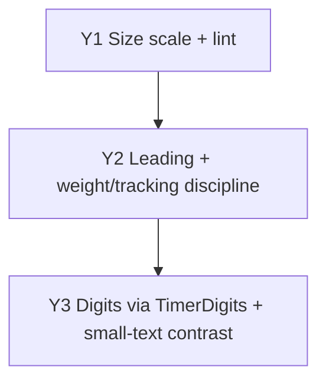

# Typography Pass — Implementation Plan (no font change)

> **Read first**: `AGENTS.md` → `docs/web_design_plan.md` §7 (design tokens proposal: scale 12/14/16/20/28/48/72, system stack, `tabular-nums`) → `docs/motion_plan.md` (A11: digits never animate).
> This file says **in what order and how**. Constraint: **no new font** — system stack + Tailwind `font-mono` stay. Only sizes, line-heights, weights, tracking, and digit consistency change.
> Baseline: branch `dev`. Paths relative to repo root.

## How agents must work

1. One task (Y1–Y3) at a time, in dependency order. Do not widen scope.
2. Every task lists **Files / Do / Tests / Done when**. A task is finished only when `npm run lint && npm test && npm run build` pass in `web/`.
3. No visual redesign: sizes snap to the nearest approved step, never invent new ones. If a `10px/11px` instance is genuinely needed (e.g. dense metadata), keep it with a `// type-allow: <reason>` comment (same convention as `motion-allow`).
4. One task = one commit, message `style(web): …` listing the `T` ids it closes.

## Findings from the current code (why this pass exists)

| # | Finding (evidence) | Task |
|---|---|---|
| T1 | Sizes are scattered: `text-xs` ×127, `text-[11px]` ×38, `text-sm` ×35, `text-[10px]` ×31, plus one-off `2xl/3xl/4xl/6xl/8xl/9xl`. The §7 scale (12/14/16/20/28/48/72) is not enforced | Y1 |
| T2 | Zero `leading-*` usages in the whole codebase — dense lists rely on Tailwind defaults | Y2 |
| T3 | All four weights in play with no convention (`font-medium` ×51, `semibold` ×47, `bold` ×35): group headers, badges, buttons each do their own thing | Y2 |
| T4 | Timer digits styled in 6+ places (`TimerBar.tsx:201`, `FocusView.tsx:229`, `FloatingPlayerIsland.tsx`, `TodayView.tsx:612`, `MediaView.tsx`, `SettingsView.tsx`) instead of through the existing `TimerDigits.tsx` | Y3 |
| T5 | The riskiest combo — `text-[10px]` + `text-[var(--muted)]` (~31 sites) — is never contrast-checked at that size (`contrast.test.ts` exists but does not cover 10–11px muted) | Y3 |

## Dependency graph

---

## Y1 — Size scale + lint (T1)

**Files**: `web/src/styles/tokens.css` (document the scale), every `*.tsx` using `text-[10px]` / `text-[11px]`, `web/scripts/check-motion-tokens.mjs` (or a new `check-type-scale.mjs`).

**Do**:

1. Record the approved scale in `tokens.css` (comment block): `12 / 14 / 16 / 20 / 28 / 48 / 72` (= `xs / sm / base / lg+ / display`). Anything else needs `// type-allow: <reason>`.
2. Replace all `text-[10px]` → `text-xs` (12px) and `text-[11px]` → `text-xs`, except cases with a recorded reason (dense timestamps, badges with padding compensation). Snap one-off headings to the nearest scale step.
3. Add a lint rule (extend the motion checker or add a type checker run from `npm run lint`): forbid `text-\[1\d?px\]` and `text-\[\d+px\]` below 12px outside `test/**` unless the line carries `type-allow:`.

**Tests**: lint fixture with `text-[10px]` fails; existing Vitest suite green.

**Done when**: `grep -rn "text-\[1[01]px\]" web/src --include='*.tsx' | grep -v type-allow` returns nothing; no visual regression in Today/Focus/Media/Settings at 360/768/1280px.

---

## Y2 — Leading + weight/tracking discipline (T2, T3)

**Files**: `web/src/views/TodayView.tsx` (rows, group headers), `web/src/components/ui/*` (Badge, Button, SegmentedControl), `web/src/views/*` (drawer, dialogs).

**Do**:

1. Leading: `leading-relaxed` for body/description text, `leading-tight` for headings and uppercase group headers (`Tasks (n)`, `Completed (n)`). Rows keep compact but readable spacing — never tighter than `leading-snug` for two-line content.
2. Weights/tracking convention (document in `tokens.css` next to the scale):
   | Role | Style |
   |---|---|
   | Group header | `semibold`, `uppercase`, `tracking-wider` |
   | Body | `normal`, emphasis via `medium` |
   | Strong emphasis / CTA | `semibold` (avoid `bold` except timer digits) |
   | Display timer (Focus) | `light` + `tracking-tighter` (keep, large sizes only) |
3. Apply the convention to TaskRow, badges, buttons, drawer titles, dialog titles. Remove `tracking-tighter` from small-size digits.

**Tests**: no new unit tests required; Playwright/visual check via `/dev/motion` gallery + screenshots at 360/1280px light/dark.

**Done when**: every screen uses at most the three roles above; `font-bold` remains only on timer digits and CTA-level elements.

---

## Y3 — Digits via `TimerDigits` + small-text contrast (T4, T5)

**Files**: `web/src/components/ui/TimerDigits.tsx`, `TimerBar.tsx:201`, `FocusView.tsx:229`, `FloatingPlayerIsland.tsx`, `TodayView.tsx:612`, `MediaView.tsx`, `SettingsView.tsx`, `web/src/test/contrast.test.ts`.

**Do**:

1. Route every timer/countdown/elapsed readout through `TimerDigits` (extend its `mode` or `size` props if a call site needs a variant — do not add new one-off `font-mono tabular-nums` class strings).
2. Extend `contrast.test.ts`: assert the `--muted`-on-surface pairs at **10–12px** (the smallest size still allowed after Y1). Any failing pair is fixed by bumping to 12px or switching to `--text` at reduced opacity (Todoist pattern: one ink, 100/66/49% steps) — pick per case, keep the token count unchanged.
3. Confirm `aria-hidden` + live-region behavior for timers is untouched (motion plan A11 / web design §5: announce minute/state changes only).

**Tests**: contrast suite covers 10–12px muted; `TimerBar`/`TimerDigits` component tests green; axe still clean.

**Done when**: `grep -rn "font-mono" web/src --include='*.tsx' | grep -v -E "TimerDigits|test|DevMotion|code|token|color"` returns only code/token displays; no muted text below 12px fails contrast.

---

## Acceptance checklist (whole pass)

- [ ] `npm run lint && npm test && npm run build` pass.
- [ ] No sub-12px text without `type-allow`; scale documented in `tokens.css`.
- [ ] Leading present on body + headings; weight/tracking follow the 3-role convention.
- [ ] All timer readouts go through `TimerDigits`; `tracking-tighter` only on large display digits.
- [ ] Contrast suite covers small muted text; screenshots at 360/768/1280px light/dark show no regression.

## Explicitly out of scope

New fonts or font loading (see font research notes — deferred by owner); color token changes; layout changes; `Field.tsx` border/blur style (tracked in round-2 plan R5).

## Open points for the owner

| # | Point | Default used in this plan |
|---|---|---|
| H1 | Keep `font-mono` for code/token/hex displays | Yes — only timer digits are unified |
| H2 | 10px metadata with a reason stays | Yes, with `type-allow` + contrast proof |
